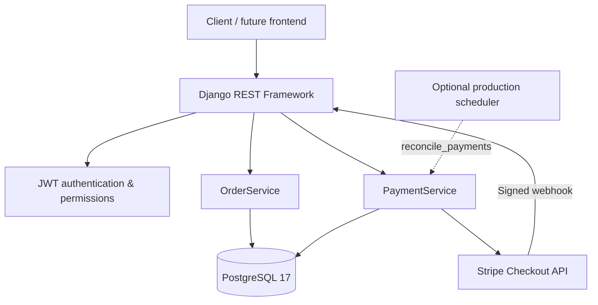
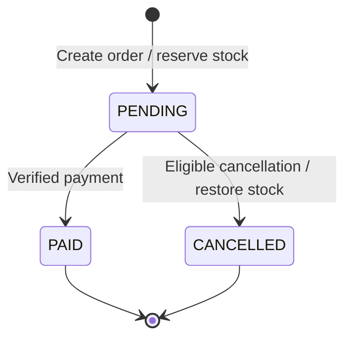

# Order Management API

[](https://github.com/stakich/django-order-management-api/actions/workflows/tests.yml)


**A transaction-safe e-commerce REST API built with Django REST Framework, PostgreSQL, and Stripe Checkout.**

Built as a hands-on backend engineering project, focusing on concurrency-safe stock management, secure access control, resilient payment workflows, automated testing, and maintainable service-layer code.

[Features](#features) · [Architecture](#architecture) · [Quick start](#quick-start) · [API documentation](#api-documentation) · [Payments](#stripe-payments) · [Testing](#testing-and-ci) · [Roadmap](#roadmap)

## Features

| Area | Capabilities |
| --- | --- |
| **Accounts** | Registration, JWT access/refresh tokens, customer/admin roles, authenticated profile endpoint |
| **Catalog** | Products and categories, filtering, search, sorting, pagination, admin-only writes |
| **Orders** | Multi-item orders, price snapshots, transactional stock reservation, cancellation and stock restoration |
| **Concurrency** | PostgreSQL row-level locks, stable locking order, serialization-failure retries, database constraints |
| **Payments** | Stripe Checkout, verified webhooks, idempotent processing, checkout recovery and reconciliation |
| **Security** | Resource ownership checks, Django password validators, JWT, scoped login/registration throttling |
| **Developer experience** | OpenAPI 3 schema, Swagger UI, Docker Compose, Ruff, automated tests, GitHub Actions, Dependabot |

### Engineering highlights

- **Atomic inventory updates:** order creation and stock reservation occur in the same database transaction.
- **Race-condition protection:** `select_for_update()` locks relevant product rows in a consistent order; PostgreSQL serialization failures can be retried.
- **Safe payment transitions:** server-calculated totals, Stripe signature verification, payment/session validation, and idempotent webhook handling.
- **Clear boundaries:** API views handle HTTP concerns; `OrderService` and `PaymentService` enforce business rules.
- **Database invariants:** constraints enforce valid quantities and stock and restrict conflicting active payments.
- **Authorization:** users access their own orders; admins have broader catalog/order permissions.

## Architecture



### Order lifecycle



### Repository structure

```text
accounts/             Registration, JWT, roles and permissions
products/             Product and category APIs
orders/               Order APIs, inventory logic and concurrency tests
payments/             Stripe Checkout, webhooks and reconciliation
config/               Django settings, URL routing and OpenAPI configuration
.github/workflows/    CI, tests and Docker image publication
.github/dependabot.yml Dependency updates
Dockerfile            Gunicorn application image (non-root)
compose.yaml          Django + PostgreSQL development stack
requirements*.txt     Application and development dependencies
pyproject.toml        Ruff and Coverage configuration
.env.example          Environment variable template
```

## Tech stack

Python 3.14 · Django 6.1 · Django REST Framework · Simple JWT · PostgreSQL 17 / psycopg · Stripe Checkout · Gunicorn · WhiteNoise · Docker Compose · Ruff · Coverage · GitHub Actions · GHCR

## Quick start

**Requirements:** Docker and Docker Compose, or Python 3.14 and a PostgreSQL 17 instance.

### Docker (recommended)

```bash
git clone https://github.com/stakich/django-order-management-api.git
cd django-order-management-api
cp .env.example .env
```

Update `.env` with your **own** database password, Django secret, and Stripe **test-mode** credentials. Generate a Django key with:

```bash
python -c "from django.core.management.utils import get_random_secret_key; print(get_random_secret_key())"
```

Start the services:

```bash
docker compose up --build
```

The API listens on `http://localhost:8000`. Compose starts PostgreSQL, runs Django migrations and launches Gunicorn.

Create an admin account:

```bash
docker compose exec web python manage.py createsuperuser
```

> Django `is_superuser` is separate from this API's `UserProfile.Role.ADMIN`. To grant API administrator privileges, set the user's profile role to `ADMIN` as well.

### Local Python development

```bash
python3.14 -m venv .venv
source .venv/bin/activate
python -m pip install -r requirements.txt
cp .env.example .env
# Set POSTGRES_HOST=127.0.0.1 in .env
docker compose up -d postgres
python manage.py migrate
python manage.py runserver
```

### Environment variables

| Variable | Usage |
| --- | --- |
| `DJANGO_SECRET_KEY` | Required cryptographic signing key |
| `DJANGO_DEBUG` | Local debugging only; use `False` in production |
| `DJANGO_ALLOWED_HOSTS` | Comma-separated permitted hostnames |
| `POSTGRES_DB`, `POSTGRES_USER`, `POSTGRES_PASSWORD` | Database credentials |
| `POSTGRES_HOST`, `POSTGRES_PORT` | Database endpoint (`postgres` within Compose) |
| `STRIPE_SECRET_KEY` | Stripe API key (test mode locally) |
| `STRIPE_WEBHOOK_SECRET` | Stripe webhook signing secret |
| `STRIPE_SUCCESS_URL`, `STRIPE_CANCEL_URL` | Checkout redirect destinations |

The example redirect URLs are **placeholders**, not implemented pages. Set them to routes that actually exist in your environment. Never commit `.env`, access tokens or Stripe keys.

## API documentation

Once the current OpenAPI changes are committed, run Django and open:

- **Swagger UI:** `http://localhost:8000/api/docs/`
- **OpenAPI schema:** `http://localhost:8000/api/schema/`

JWT-secured operations are testable in Swagger UI using **Authorize** with an access token.

Validate the schema:

```bash
python manage.py spectacular --validate --fail-on-warn > /dev/null
```

### Endpoint overview

The following paths are relative to `/api/v1/`.

| Method | Endpoint | Access |
| --- | --- | --- |
| `POST` | `auth/register/` | Public; throttled |
| `POST` | `auth/login/` | Public; throttled |
| `POST` | `auth/token/refresh/` | Refresh token |
| `GET` | `auth/me/` | Authenticated |
| `GET` | `products/`, `products/{id}/` | Public |
| `POST`, `PUT`, `PATCH`, `DELETE` | `products/…` | Admin |
| `GET` | `categories/`, `categories/{id}/` | Public |
| `POST`, `PUT`, `PATCH`, `DELETE` | `categories/…` | Admin |
| `GET`, `POST` | `orders/` | Authenticated |
| `GET` | `orders/{id}/` | Owner or admin |
| `POST` | `orders/{id}/cancel/` | Authorized user, eligible order |
| `POST` | `orders/{id}/checkout/` | Order owner |
| `POST` | `payments/stripe/webhook/` | Valid Stripe signature |

Example login:

```bash
curl -X POST http://localhost:8000/api/v1/auth/login/ \
  -H 'Content-Type: application/json' \
  -d '{"username":"your-username","password":"your-password"}'
```

Authenticated requests use `Authorization: Bearer <access_token>`.

## Stripe payments

1. A customer places an order; stock is reserved transactionally.
2. The customer requests `POST /api/v1/orders/{id}/checkout/`.
3. The API creates or reuses an appropriate Stripe Checkout Session using an idempotency key.
4. Stripe sends a signed webhook to `/api/v1/payments/stripe/webhook/`.
5. The API verifies the event and matching payment details before updating payment/order state.
6. Reconciliation can recover eligible payments with known Stripe Checkout Sessions if a webhook was missed.

To forward **test-mode** webhooks locally:

```bash
stripe listen --events checkout.session.completed,checkout.session.async_payment_succeeded,checkout.session.async_payment_failed,checkout.session.expired \
  --forward-to localhost:8000/api/v1/payments/stripe/webhook/
```

Use the `whsec_...` value printed by Stripe CLI as `STRIPE_WEBHOOK_SECRET` and restart Django.

### Payment reconciliation

```bash
python manage.py reconcile_payments --minutes 15
```

This command checks old, pending Stripe payments with recorded Checkout Session IDs and delegates reconciliation to `PaymentService`. It is **not automatically scheduled** by Django; a periodic scheduler can be configured at deployment. Payments missing a recorded session ID are not covered by this command.

## Testing and CI

```bash
python manage.py test -v 2
python manage.py spectacular --validate --fail-on-warn > /dev/null
python -m pip install -r requirements-dev.txt
ruff check .
coverage run manage.py test -v 2
coverage report
```

Tests cover authentication and authorization, catalog, order/inventory transactions, concurrency, Stripe Checkout, webhook signatures, reconciliation, and throttling.

The [CI workflow](https://github.com/stakich/django-order-management-api/actions/workflows/tests.yml) runs Ruff, Django checks, migration checks and tests against PostgreSQL 17. Docker images are built on pull requests and published to [GitHub Container Registry](https://github.com/stakich/django-order-management-api/pkgs/container/django-order-management-api) on pushes to `main`. Dependabot checks Python, Actions and Docker dependencies.

```bash
docker pull ghcr.io/stakich/django-order-management-api:latest
```

The image registry is **not** a running deployment. Use an immutable SHA tag for reproducible production releases.

## Security and production notes

- JWT access tokens and per-resource permission checks protect authenticated endpoints.
- Login is throttled at **5 requests/minute** and registration at **3 requests/hour** in the current local implementation.
- DRF throttling is a basic abuse control, **not** a substitute for edge-level rate limiting or DDoS protection. Configure a shared cache if deploying multiple application processes.
- Stripe webhook events require signature verification; repeated deliveries must not double-apply business operations.
- Keep `DJANGO_DEBUG=False`, use a strong `DJANGO_SECRET_KEY`, configure HTTPS and secure cookies, and run `python manage.py check --deploy` before production deployment.
- A production mail backend, HTTPS/HSTS policy, and scheduled payment reconciliation are deployment tasks.

## Roadmap

- [x] Products, categories, search/filtering and role-based access
- [x] Transactional orders and concurrency-safe stock management
- [x] Stripe Checkout, signed webhook handling and payment recovery helpers
- [x] Reconciliation management command and automated tests (local implementation)
- [x] JWT authentication and scoped authentication throttling (local implementation)
- [x] OpenAPI schema, validation and Swagger UI (local implementation)
- [x] Docker / PostgreSQL setup, CI, Ruff, Coverage, Dependabot and GHCR publishing
- [ ] React + TypeScript frontend
- [ ] Public production deployment with HTTPS and production mail configuration
- [ ] Configure recurring payment reconciliation at deployment

## Project status

**Backend MVP completed; frontend planned.** The latest authentication hardening, reconciliation command and Swagger additions have been tested locally and should be committed together with this README.

---

Maintained by [@stakich](https://github.com/stakich). Contributions and feedback are welcome via GitHub Issues.
