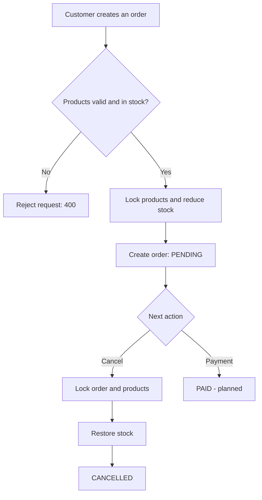

# 🛒 Order Management API

**A transactional e-commerce backend built with Django REST Framework**

`Django` · `Django REST Framework` · `PostgreSQL 17` · `Docker Compose` · `JWT`

A backend project focused on **order workflows**, **inventory consistency under concurrent requests**, **role-based access control** and a **clean separation of business logic from HTTP code**.

> **Status:** products, accounts and order workflows are implemented. The `payments` app is scaffolded; Stripe Checkout and webhooks are **planned, not implemented yet** (see the [roadmap](#-roadmap)).

## ✨ Overview

The API provides the backend of a small online store. Customers browse products, place orders with multiple items, view their own orders and cancel eligible ones. Administrators can see all orders.

Creating an order reserves stock and cancelling a pending order restores it. Database transactions and PostgreSQL row-level locks keep inventory correct when requests arrive at the same time.

## 🔑 Key engineering decisions

- **All-or-nothing orders:** order creation and stock changes run inside one `transaction.atomic()` block.
- **Row-level locking:** `SELECT ... FOR UPDATE` on products during inventory changes, with a stable lock order to reduce deadlock risk.
- **Retry on serialization failures:** a helper retries operations that fail with PostgreSQL `SQLSTATE 40001`.
- **Service layer:** business rules live in `OrderService`; views only handle authentication, validation and HTTP responses.
- **Price snapshots:** each order item stores its `unit_price` at checkout, so later catalog changes never rewrite past orders.
- **Safe access control:** orders that belong to other users return `404 Not Found` instead of revealing that they exist.

## ✅ Features

**Products**
- Products with name, description, SKU, price, stock, category and active status
- Product list and detail endpoints
- Stock and availability checks during order creation

**Accounts and authentication**
- Registration with password confirmation and unique-email validation
- JWT authentication with Simple JWT
- `UserProfile` with `CUSTOMER` and `ADMIN` roles

**Orders and inventory**
- Create an order with one or more items
- Reject invalid quantities, duplicate products, inactive products and insufficient stock
- List orders and retrieve order details (own orders for customers, all orders for admins)
- Cancel a `PENDING` order and restore its stock exactly once
- Block repeated cancellations and invalid state transitions

## 🏗 Architecture

```
Client (HTTP / JSON)
        │
        ▼
Django REST Framework views
  ├─ Authentication and permissions
  ├─ Request validation / serialization
  └─ HTTP response and error mapping
        │
        ▼
Service layer (OrderService)
  ├─ Order creation / cancellation
  ├─ Business rule validation
  └─ Atomic transactions and locking
        │
        ▼
Django ORM → PostgreSQL 17
```

### Project structure

```
.
├── accounts/       # Registration, user profiles, roles
├── products/       # Product catalog and categories
├── orders/         # Orders, order items, services, serializers
│   └── utils/      # Database transaction retry helper
├── payments/       # Scaffolded; Stripe integration is planned
├── config/         # Django settings and root URL configuration
├── compose.yaml    # PostgreSQL for local development
├── requirements.txt
├── .env.example    # Example configuration (no real secrets)
└── manage.py
```

## 🔄 Order lifecycle



Implemented states: `PENDING`, `PAID`, `CANCELLED`. New orders start as `PENDING`, and cancelling changes `PENDING → CANCELLED`. Automatic `PENDING → PAID` transitions after payment are not implemented yet.

## 🧰 Tech stack

| Layer | Technology |
|---|---|
| Language | Python |
| Web framework | Django |
| REST API | Django REST Framework |
| Authentication | Simple JWT |
| Filtering | django-filter |
| Database | PostgreSQL 17 |
| Local infrastructure | Docker Compose |
| Configuration | python-dotenv, environment variables |

## 🚀 Getting started

**Prerequisites:** Python 3.14 (used in development), Docker with Docker Compose, Git.

```bash
# 1. Clone the project
git clone https://github.com/stakich/django-order-management-api.git
cd django-order-management-api

# 2. Create and activate a virtual environment
python -m venv .venv
source .venv/bin/activate        # Windows: .venv\Scripts\activate

# 3. Install dependencies
pip install -r requirements.txt

# 4. Configure environment variables
cp .env.example .env             # then edit .env with your own values

# 5. Start PostgreSQL
docker compose up -d postgres

# 6. Apply migrations and run the API
python manage.py migrate
python manage.py runserver
```

The API is available at `http://127.0.0.1:8000/api/v1/`.

Generate a Django secret key for `.env` with:

```bash
python -c "from django.core.management.utils import get_random_secret_key; print(get_random_secret_key())"
```

> Never commit `.env`. PostgreSQL is exposed only on `127.0.0.1:5432` and its data persists in the `postgres_data` volume. Do not run `docker compose down -v` unless you want to delete the database.

## 📡 API overview

| Method | Endpoint | Description | Auth |
|---|---|---|---|
| `POST` | `/api/v1/auth/register/` | Register a new user | Public |
| `POST` | `/api/v1/auth/login/` | Obtain JWT tokens | Public |
| `GET` | `/api/v1/products/` | List products | Configured permissions |
| `GET` | `/api/v1/orders/` | List own orders (all for admin) | Required |
| `POST` | `/api/v1/orders/` | Create an order | Required |
| `GET` | `/api/v1/orders/{id}/` | Retrieve a permitted order | Required |
| `POST` | `/api/v1/orders/{id}/cancel/` | Cancel a pending order | Required |

### Example: log in

```bash
curl -X POST http://127.0.0.1:8000/api/v1/auth/login/ \
  -H 'Content-Type: application/json' \
  -d '{"username":"your_username","password":"your_password"}'
```

Store the returned `access` token without printing it:

```bash
read -rsp 'JWT access token: ' ACCESS_TOKEN; echo
```

### Example: create an order

```bash
curl -i -X POST http://127.0.0.1:8000/api/v1/orders/ \
  -H "Authorization: Bearer $ACCESS_TOKEN" \
  -H 'Content-Type: application/json' \
  -d '{"items": [{"product": 1, "quantity": 2}, {"product": 2, "quantity": 3}]}'
```

Expected: `201 Created`, a new `PENDING` order and reduced stock.

### Example: cancel an order

```bash
curl -i -X POST http://127.0.0.1:8000/api/v1/orders/2/cancel/ \
  -H "Authorization: Bearer $ACCESS_TOKEN"
```

Expected: `200 OK` with `"status": "CANCELLED"` and the stock restored.

### Common errors

| Status | Meaning |
|---|---|
| `400 Bad Request` | Invalid order data, or the order cannot be cancelled |
| `401 Unauthorized` | Missing, invalid or expired JWT |
| `404 Not Found` | The order does not exist or is not accessible to the user |

## 📏 Business rules

1. A new order starts as `PENDING`.
2. An order must contain at least one valid item with a positive quantity.
3. The same product cannot appear twice in one order.
4. Products must be active and have enough stock.
5. Stock changes and order creation happen in one database transaction.
6. Customers see and cancel only their own orders; administrators have broader access.
7. Only `PENDING` orders can be cancelled, and cancellation restores each quantity exactly once.
8. Order item prices are snapshots of the price at checkout.
9. Payment confirmation will be verified server-side before an order is marked `PAID`.

## 🗺 Roadmap

- [x] Products and categories
- [x] Registration, JWT authentication and customer/admin roles
- [x] Transactional order creation with inventory deduction
- [x] Order listing, details and cancellation with stock restoration
- [x] PostgreSQL row locking and serialization retry helper
- [ ] Automated tests (order creation, cancellation, concurrent stock updates)
- [ ] Payment model and payment attempt tracking
- [ ] Stripe Checkout integration (test mode)
- [ ] Verified Stripe webhook processing and automatic `PENDING → PAID`
- [ ] Idempotency and protection against payment/cancellation races
- [ ] OpenAPI / Swagger documentation
- [ ] Production deployment configuration

---

Built as a hands-on Django backend project by [@stakich](https://github.com/stakich).