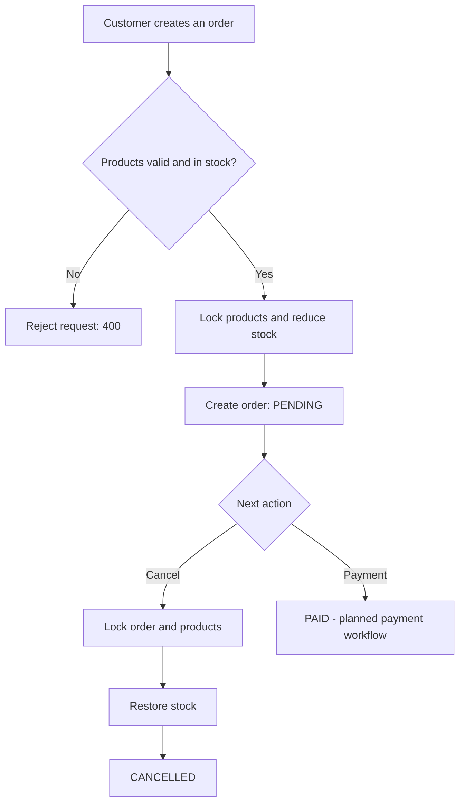

<div align="center">

# 🛒 Order Management API

### A transactional e-commerce backend built with Django REST Framework

**Django · Django REST Framework · PostgreSQL 17 · Docker · JWT Authentication**

A backend learning project focused on **real-world order workflows**, **inventory consistency**, **secure access control**, and **clean separation of business logic**.

[Features](#-features) · [Architecture](#-architecture) · [Getting Started](#-getting-started) · [API](#-api-overview) · [Business Rules](#-business-rules) · [Roadmap](#-roadmap)

</div>

---

## ✨ Overview

Order Management API provides the backend foundation for a small online store. Customers can browse products, create orders containing multiple items, view their own orders, and cancel eligible orders. Administrators have broader order visibility.

The core of the project is **transactional inventory management**: creating an order reserves stock, while cancelling an eligible order restores it. Database transactions and PostgreSQL row-level locks help keep the inventory consistent when concurrent requests arrive.

> **Project status:** Product, account and order workflows are implemented. A `payments` Django app has been created, but real payment processing and Stripe integration are **planned, not implemented**.

## ✅ Features

### Products & categories
- Products with name, description, SKU, price, stock, category and active status.
- Product listing and detail access through a REST API.
- Product availability checks during order creation.
- Role-based product management capabilities.

### Accounts & authentication
- User registration with password confirmation and unique-email validation.
- Password hashing using Django's built-in user management.
- JWT-based authentication via Django REST Framework Simple JWT.
- `UserProfile` with `CUSTOMER` and `ADMIN` roles.
- Customer data access restricted to their own orders; administrators can view all orders.

### Orders & inventory
- Create an order containing one or more products.
- Save the price of each item at checkout (`unit_price`), preserving historical order prices.
- Reject invalid quantities, duplicate products, inactive products and insufficient stock.
- Decrement inventory as part of the order creation transaction.
- List orders and retrieve individual order details.
- Cancel a **PENDING** order and restore its reserved stock.
- Prevent repeated cancellations and invalid order-state transitions.
- Hide inaccessible orders behind `404 Not Found` responses.

### Reliability & concurrency
- `transaction.atomic()` for all-or-nothing order mutations.
- PostgreSQL `SELECT ... FOR UPDATE` row locking during inventory changes.
- Stable product-lock ordering to reduce concurrency hazards.
- Retry helper for PostgreSQL serialization failures (`SQLSTATE 40001`).
- Custom service-layer exceptions mapped to appropriate HTTP responses in views.

## 🏗 Architecture

The project separates **HTTP concerns** from **business rules**:

```text
Client (HTTP / JSON)
        │
        ▼
Django REST Framework Views
  ├─ Authentication & permissions
  ├─ Request validation / serialization
  └─ HTTP response & error mapping
        │
        ▼
Service Layer (OrderService)
  ├─ Order creation / cancellation
  ├─ Business rule validation
  └─ Atomic transactions / locking
        │
        ▼
Django ORM → PostgreSQL 17
```

### Django applications

```text
.
├── accounts/       # Registration, user profiles, roles
├── products/       # Product catalog and categories
├── orders/         # Orders, order items, services, serializers
│   └── utils/      # Database transaction retry helper
├── payments/       # Scaffolded; payment integration is next
├── config/         # Django settings and root URL configuration
├── docker-compose.yml
├── manage.py
├── .env.example     # Example configuration (no real secrets)
└── README.md
```

> Directory structure is illustrative; certain modules (such as `payments/services.py`) will be added as the project develops.

## 🔄 Order lifecycle



**Current implemented states:** `PENDING`, `PAID`, `CANCELLED`. Creation defaults to `PENDING`; cancellation changes `PENDING → CANCELLED`. **Automatic payment-driven transitions to `PAID` are not implemented yet.**

## 🧰 Tech stack

| Layer | Technology |
|---|---|
| Language | Python |
| Web framework | Django |
| REST API | Django REST Framework |
| Authentication | Simple JWT |
| Filtering | django-filter |
| Database | PostgreSQL 17 |
| Database access | Django ORM |
| Local infrastructure | Docker Compose |
| Configuration | python-dotenv / environment variables |

## 🚀 Getting started

### Prerequisites

- Python and pip (the project is being developed with Python 3.14)
- Docker with Docker Compose
- Git

### 1. Clone the project

```bash
git clone https://github.com/stakich/django-order-management-api.git
cd django-order-management-api
```

### 2. Create a virtual environment

```bash
python -m venv .venv
source .venv/bin/activate
```

### 3. Install dependencies

```bash
pip install -r requirements.txt
```

> Before publishing, generate and commit `requirements.txt` from your working environment if it does not yet exist: `python -m pip freeze > requirements.txt`.

### 4. Configure environment variables

Copy the example configuration and edit it locally:

```bash
cp .env.example .env
```

Example `.env.example` content:

```dotenv
DJANGO_SECRET_KEY=replace-with-a-random-secret-key
DJANGO_DEBUG=True
POSTGRES_DB=order_management
POSTGRES_USER=django_user
POSTGRES_PASSWORD=replace-with-a-strong-password
POSTGRES_HOST=127.0.0.1
POSTGRES_PORT=5432
```

Generate a Django secret key with:

```bash
python -c "from django.core.management.utils import get_random_secret_key; print(get_random_secret_key())"
```

**Never commit `.env`, passwords, private keys or access tokens.** This project expects secrets in environment variables.

### 5. Start PostgreSQL

```bash
docker compose up -d postgres
```

Docker Compose exposes PostgreSQL only on `127.0.0.1:5432` and persists data in the `postgres_data` volume. The Django application runs on the host in this development setup.

> Do not run `docker compose down -v` unless you intentionally want to delete the database volume.

### 6. Apply database migrations

```bash
python manage.py migrate
python manage.py check
```

### 7. Start the API

```bash
python manage.py runserver
```

Local API base URL: `http://127.0.0.1:8000/api/v1/`

## 📡 API overview

The following routes reflect the currently discussed API implementation. Confirm the exact authentication and product URL prefixes against the project's `urls.py` before publishing.

| Method | Endpoint | Description | Auth |
|---|---|---|---|
| `POST` | `/api/v1/auth/register/` | Register a new user | Public |
| `POST` | `/api/v1/auth/login/` | Obtain JWT tokens | Public |
| `GET` | `/api/v1/products/` | List products | Configured permissions |
| `GET` | `/api/v1/orders/` | List own orders (all for admin) | Required |
| `POST` | `/api/v1/orders/` | Create an order | Required |
| `GET` | `/api/v1/orders/{id}/` | Retrieve permitted order | Required |
| `POST` | `/api/v1/orders/{id}/cancel/` | Cancel pending order | Required |

### Example: log in

```bash
curl -X POST http://127.0.0.1:8000/api/v1/auth/login/ \
  -H 'Content-Type: application/json' \
  -d '{"username":"your_username","password":"your_password"}'
```

Copy the returned **access** token to your shell without printing it:

```bash
read -rsp 'JWT access token: ' ACCESS_TOKEN; echo
```

### Example: create an order

The API accepts the field **`product`** (not `product_id`) for order item input:

```bash
curl -i -X POST http://127.0.0.1:8000/api/v1/orders/ \
  -H "Authorization: Bearer $ACCESS_TOKEN" \
  -H 'Content-Type: application/json' \
  -d '{
    "items": [
      {"product": 1, "quantity": 2},
      {"product": 2, "quantity": 3}
    ]
  }'
```

**Expected:** `201 Created`, a new `PENDING` order and reduced inventory.

### Example: cancel an order

```bash
curl -i -X POST http://127.0.0.1:8000/api/v1/orders/2/cancel/ \
  -H "Authorization: Bearer $ACCESS_TOKEN"
```

**Expected on success:** `200 OK` with `"status": "CANCELLED"`; ordered quantities are returned to inventory.

### Typical order errors

| HTTP status | Meaning |
|---|---|
| `400 Bad Request` | Invalid order data or order cannot be cancelled |
| `401 Unauthorized` | Missing, invalid or expired JWT |
| `404 Not Found` | Order does not exist or is inaccessible to the user |

## 📏 Business rules

1. A new order starts in `PENDING` status.
2. An order must contain at least one valid product item with positive quantity.
3. The same product cannot be included twice in the same order request.
4. Products must be active and have sufficient stock.
5. Stock changes and order creation occur in one database transaction.
6. Customers see and cancel only their own orders; administrators have broader access.
7. Only `PENDING` orders may be cancelled.
8. Cancellation restores each item's quantity **exactly once**.
9. Order item prices are snapshots; changes to the product catalog do not rewrite past prices.
10. Payment confirmation must eventually be validated server-side before marking orders as `PAID`.

## 🛡 Security notes

- Credentials and Django `SECRET_KEY` are loaded from environment variables.
- JWT is required for protected order endpoints.
- Service-level ownership checks prevent access to someone else's order.
- Failed business operations are rolled back with database transactions.
- Secrets, virtual environments and IDE files should be excluded through `.gitignore`.
- `DJANGO_DEBUG=True` and Django's built-in development server are **development-only** settings.

## 🗺 Roadmap

- [x] Product and category models
- [x] Customer registration and JWT authentication
- [x] User profiles and customer/admin roles
- [x] Transactional order creation with inventory deduction
- [x] Customer/admin order listing and detail access
- [x] Order cancellation and inventory restoration
- [x] PostgreSQL row locking and serialization retry helper
- [ ] Payment model and payment attempt tracking
- [ ] Stripe Checkout integration (test mode)
- [ ] Verified Stripe webhook processing
- [ ] Automatic `PENDING → PAID` transition after successful payment
- [ ] Idempotency and safeguards against payment/cancellation races
- [ ] API documentation (OpenAPI / Swagger)
- [ ] Production deployment configuration

## 🎯 Learning goals

This project is built to practice backend concepts beyond basic CRUD:

- REST API design and HTTP status handling
- Serializer validation and business-service boundaries
- Authentication versus authorization
- Django ORM relationships and query optimization
- Transactions, row-level locks and concurrency control
- Domain-specific exceptions
- External payment-service integration and webhook security

---

<div align="center">

**Built as a hands-on Django backend project.**

Maintained by [@stakich](https://github.com/stakich).

</div>
