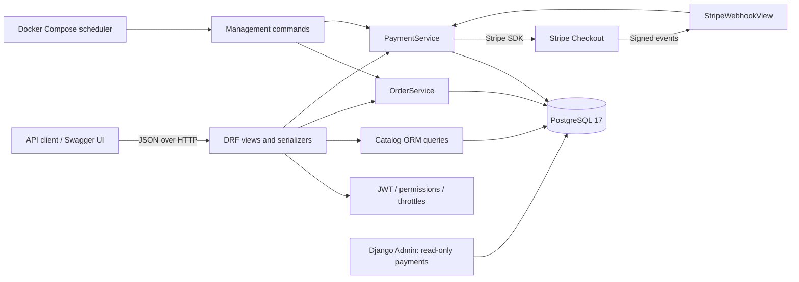
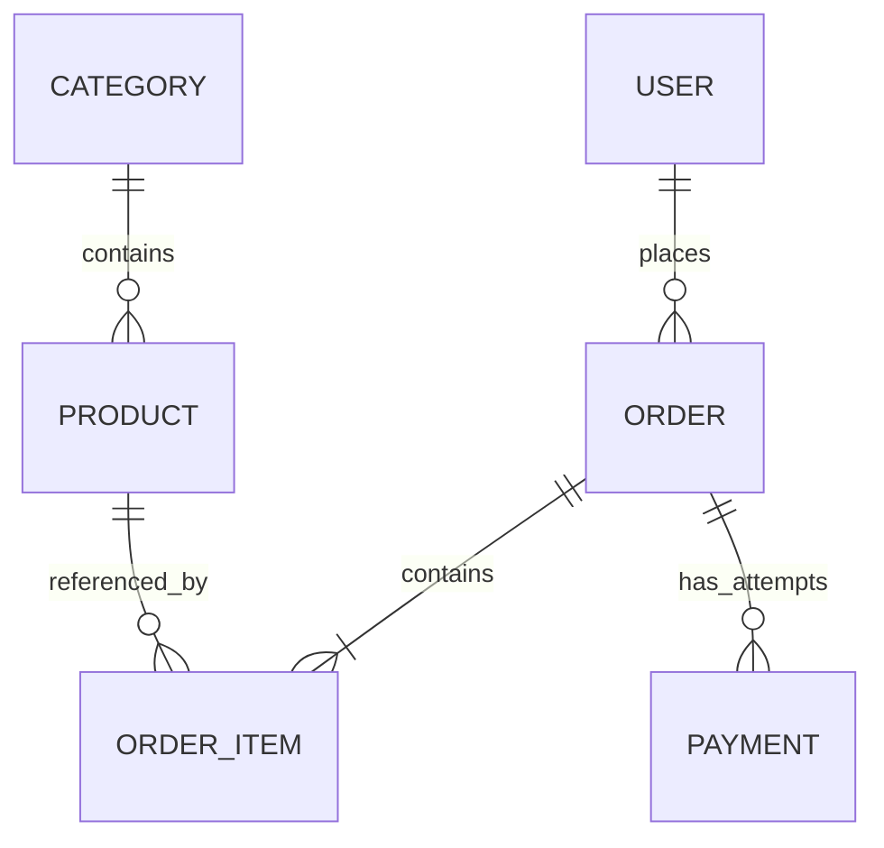
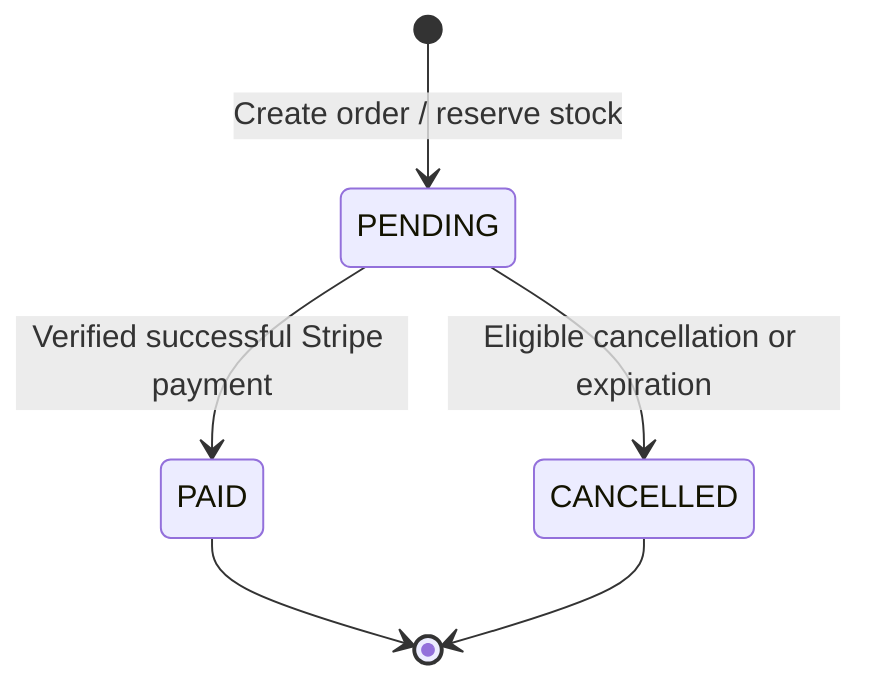
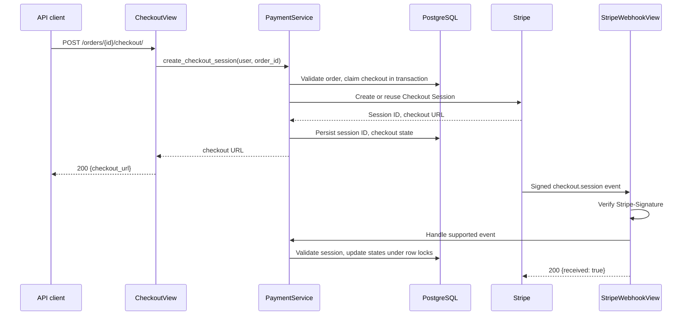

# Order Management API

[](https://github.com/stakich/django-order-management-api/actions/workflows/tests.yml)


**A transaction-safe e-commerce REST API built with Django REST Framework, PostgreSQL and Stripe Checkout.**

A backend portfolio project focused on concurrency-safe inventory, clear service boundaries, secure access control and recoverable payment workflows. Stripe is used in **test mode**; this project is not a production payment platform.

[Features](#features) · [High-level design](#high-level-api-design) · [Low-level design](#low-level-api-design) · [Quick start](#quick-start) · [API](#api-documentation) · [Payments](#stripe-payments) · [Testing](#testing-and-ci) · [Limitations](#known-limitations)

## Features

| Area | Capabilities |
| --- | --- |
| **Accounts** | Registration, JWT access and refresh tokens, customer/admin roles, authenticated profile |
| **Catalog** | Products and categories, filtering, search, sorting, pagination, admin-only writes |
| **Orders** | Multi-item orders, price snapshots, transactional stock reservation, cancellation and expiration |
| **Concurrency** | PostgreSQL row-level locking, consistent lock ordering, serialization-failure retries, database constraints |
| **Payments** | Stripe Checkout, signed webhooks, idempotent transitions, checkout recovery and reconciliation |
| **Operations** | Docker Compose maintenance scheduler, management commands, read-only Payment Admin |
| **Security** | Ownership checks, JWT authentication, scoped login/registration/checkout throttling |
| **Developer experience** | OpenAPI/Swagger UI, Ruff, automated tests, coverage, GitHub Actions, Dependabot |

### Engineering highlights

- **Atomic stock reservation:** order creation and inventory updates execute within a database transaction.
- **Race-condition protection:** product rows are locked in a stable order; eligible serialization failures are retried.
- **Payment integrity:** totals are calculated server-side; Stripe signatures, session identity, amount and currency are validated before state transitions.
- **Idempotent handling:** repeated payment webhook deliveries do not repeat successful order transitions.
- **Separation of responsibilities:** HTTP behavior lives in API views; business rules live in `OrderService` and `PaymentService`.
- **Database invariants:** constraints protect order-item quantities, stock and active-payment uniqueness.

## Architecture

### High-Level API Design

The API is a **modular Django monolith**, not a collection of microservices. Django REST Framework exposes JSON endpoints under `/api/v1/`; domain services enforce order and payment rules; PostgreSQL is the source of truth. Stripe is an external payment provider. A separate Docker Compose process runs recurring maintenance commands.



**Component responsibilities**

| Component | Responsibility |
| --- | --- |
| `accounts`, `products`, `orders`, `payments` API views | Routing, authentication/permissions, request validation and HTTP responses |
| DRF serializers | Validate incoming data and serialize API responses |
| `OrderService` | Inventory reservation, order creation, cancellation and safe expiration |
| `PaymentService` | Checkout creation, Stripe session verification, webhook transitions and recovery |
| PostgreSQL | Persistent state, row-level locks and database constraints |
| Stripe | Hosted checkout and payment status events; the server never trusts the browser redirect as proof of payment |
| `expire_orders`, `reconcile_payments` | Periodic maintenance, invoked by the Compose scheduler or manually |

### Low-Level API Design

#### Endpoint contracts

All application endpoints below use the `/api/v1/` prefix and JSON request/response bodies unless noted otherwise. JWT-protected endpoints use `Authorization: Bearer <access_token>`. See [the endpoint overview](#endpoint-overview) and [Swagger UI](#api-documentation) for the complete API surface.

| Operation | HTTP endpoint | Input | Success response | Access |
| --- | --- | --- | --- | --- |
| Register | `POST auth/register/` | `username`, `email`, `password`, `password_confirm` | `201` user fields | Public; `3/hour` throttle |
| Login | `POST auth/login/` | `username`, `password` | `200` access/refresh JWTs | Public; `5/min` throttle |
| Browse products | `GET products/` | Optional `search`, `category`, `is_active`, `ordering`, `page`, `page_size` | `200` paginated products | Public; only active products for non-admins |
| Create order | `POST orders/` | `items: [{product, quantity}]` | `201` order with item snapshots | Authenticated |
| Read order | `GET orders/{id}/` | URL ID | `200` order with items | Owner or API admin |
| Cancel order | `POST orders/{id}/cancel/` | URL ID; no body required | `200` updated order | Owner or API admin; eligible orders only |
| Start checkout | `POST orders/{id}/checkout/` | URL ID; no body required | `200` `checkout_url` | Order owner; `10/min` throttle |
| Stripe webhook | `POST payments/stripe/webhook/` | Raw Stripe event + `Stripe-Signature` header | `200` `{ "received": true }` | Valid Stripe signature; no JWT |

Product list pagination defaults to **10 items per page**; `page_size` can request up to **100**. Order detail/list access is restricted to the owner or an API admin. Product/category writes require `UserProfile.Role.ADMIN` (separate from Django staff/superuser permissions).

#### Request / response examples

**Create an order:** the client sends product IDs and quantities only. The server reads product prices and saves per-order `unit_price` snapshots; it does **not** accept client-provided prices.

```http
POST /api/v1/orders/
Authorization: Bearer <access_token>
Content-Type: application/json

{
  "items": [
    {"product": 1, "quantity": 2},
    {"product": 2, "quantity": 1}
  ]
}
```

On success (`201 Created`), the response uses `OrderSerializer` and includes the generated `id`, `user`, `status`, `expires_at`, timestamps, and nested `items` with saved `unit_price` values. An order starts as `PENDING`. Its default reservation expiration is **30 minutes** after creation; an expired order is not automatically cancelled until the maintenance command processes it.

**Create or reuse checkout:** the request has no JSON body. A successful call returns a Stripe-hosted URL; the client must not mark the order as paid based on this response or on the success redirect.

```http
POST /api/v1/orders/42/checkout/
Authorization: Bearer <access_token>
```

```json
{
  "checkout_url": "https://checkout.stripe.com/c/pay/cs_test_example"
}
```

The URL and IDs above are illustrative, not live Stripe credentials. Repeated checkout requests may reuse a verified open Checkout Session rather than creating another one.

**Stripe webhook:** Stripe sends the raw event body and the `Stripe-Signature` header. `StripeWebhookView` verifies the signature and handles supported `checkout.session.*` events; successful receipt is acknowledged with `{"received": true}`. Business failures requiring investigation are logged; the HTTP acknowledgement alone does not imply that an order became paid.

#### Data model and invariants



| Entity | Important fields / guarantees |
| --- | --- |
| `Order` | `user_id`, `status`, `expires_at`; statuses: `PENDING`, `PAID`, `CANCELLED` |
| `OrderItem` | `order_id`, `product_id`, `quantity >= 1`, `unit_price >= 0`; unique `(order, product)`; order-time price snapshot |
| `Product` | `price`, `stock >= 0`, `is_active`, `category_id`; unique `sku` |
| `Payment` | `order_id`, `amount`, `currency`, `status`, `checkout_status`, `stripe_session_id`, `checkout_claimed_at`, `last_reconciled_at`; unique non-null Stripe session ID |

A conditional database constraint allows at most **one payment in `PENDING` or `SUCCEEDED` status per order**; `FAILED` attempts remain available as history. Payment processing uses two independent state dimensions:

- `Payment.status`: `PENDING` → `SUCCEEDED` or `FAILED`.
- `Payment.checkout_status`: `NOT_STARTED`, `CREATING`, `READY`, `EXPIRED` (checkout-session lifecycle, not proof of payment).

**Order state machine**



Cancellation or expiration restores stock only when payment-state checks establish that doing so is safe.

#### Checkout and webhook sequence



The diagram illustrates the successful checkout path. Real execution can reuse an existing session, reject an ineligible order or defer resolution of a Stripe operation with an uncertain outcome.

#### Validation, concurrency and failure handling

- **Order creation:** the input serializer requires a nonempty item list and positive integer product IDs/quantities. `OrderService` rejects duplicate products, inactive products and insufficient stock. Product rows are locked with `select_for_update()` in ascending ID order; order creation and stock deduction happen in one `transaction.atomic()` block. Eligible PostgreSQL serialization failures are retried up to three attempts at the view boundary.
- **Checkout:** only the order owner can pay a pending, unexpired order. The amount is calculated from saved `OrderItem.unit_price` values, then sent to Stripe in integer cents. Checkout creation uses the Stripe idempotency key `checkout-payment-{payment.id}` and a `CREATING` claim to limit duplicate creation.
- **Webhooks:** verify Stripe's signature before processing; validate session identity, metadata, amount, currency and state. Payment updates lock the `Order` row before the `Payment` row. A repeated successful event must not apply the payment/order transition twice. `StripeWebhookView` is intentionally not protected by JWT; it uses Stripe signature verification instead.
- **Maintenance:** `expire_orders` safely cancels eligible expired orders; `reconcile_payments --minutes 15 --limit 100` rechecks old pending payments with known sessions, using `last_reconciled_at` to claim work. The Compose scheduler invokes these sequentially.

Typical HTTP responses include `400` for invalid requests or disallowed transitions, `401` for missing authentication, `403` for insufficient API permissions, `404` for inaccessible orders, `429` for throttled requests and `503` for a Stripe provider failure. Actual errors depend on the endpoint and state; use the generated OpenAPI schema and tests as the contract source of truth.

### Repository structure

```text
accounts/             Registration, JWT, roles and permissions
products/             Product and category APIs
orders/               Order APIs, inventory service and expiration command
payments/             Stripe Checkout, webhook handlers and reconciliation command
config/               Django settings, routing and OpenAPI configuration
.github/workflows/    CI tests and Docker image publishing
.github/dependabot.yml Dependency update configuration
Dockerfile            Gunicorn application image (non-root)
compose.yaml          PostgreSQL, web and scheduler services
requirements*.txt     Runtime and development dependencies
pyproject.toml        Ruff and Coverage configuration
.env.example          Local environment template
```

## Tech stack

Python 3.14 · Django 6.1 · Django REST Framework · Simple JWT · PostgreSQL 17 · psycopg · Stripe Checkout · Gunicorn · WhiteNoise · Docker Compose · Ruff · Coverage · GitHub Actions · GHCR

## Quick start

**Requirements:** Docker and Docker Compose, or Python 3.14 and PostgreSQL 17.

### Docker (recommended)

```bash
git clone https://github.com/stakich/django-order-management-api.git
cd django-order-management-api
cp .env.example .env
```

Set your own PostgreSQL password, Django secret and **Stripe test-mode** credentials in `.env`. You can generate a Django secret with:

```bash
python -c "from django.core.management.utils import get_random_secret_key; print(get_random_secret_key())"
```

Start PostgreSQL, the web API and the maintenance scheduler:

```bash
docker compose up -d --build
docker compose ps
```

The API is available at `http://localhost:8000`. The `web` service applies migrations before starting Gunicorn; the `scheduler` service executes periodic maintenance commands. Inspect logs with:

```bash
docker compose logs -f web
docker compose logs -f scheduler
```

Create a Django admin account:

```bash
docker compose exec web python manage.py createsuperuser
```

Visit `http://localhost:8000/admin/`. Payment records are available for viewing but cannot be added, edited or deleted through Django Admin.

> Django `is_superuser` / `is_staff` is separate from this API's `UserProfile.Role.ADMIN`. Grant the profile role separately for API administrator permissions.

### Local Python development

```bash
python3.14 -m venv .venv
source .venv/bin/activate
python -m pip install -r requirements.txt -r requirements-dev.txt
cp .env.example .env
# Set POSTGRES_HOST=127.0.0.1 in .env
docker compose up -d postgres
python manage.py migrate
python manage.py runserver
```

When running Django outside Compose, maintenance commands must be invoked manually or scheduled separately.

### Environment variables

| Variable | Purpose |
| --- | --- |
| `DJANGO_SECRET_KEY` | Django signing key |
| `DJANGO_DEBUG`, `DJANGO_ALLOWED_HOSTS` | Debugging mode and allowed hosts |
| `POSTGRES_DB`, `POSTGRES_USER`, `POSTGRES_PASSWORD` | PostgreSQL credentials |
| `POSTGRES_HOST`, `POSTGRES_PORT` | Database endpoint (`postgres` inside Compose) |
| `STRIPE_SECRET_KEY` | Stripe test-mode API key |
| `STRIPE_WEBHOOK_SECRET` | Stripe webhook signing secret |
| `STRIPE_SUCCESS_URL`, `STRIPE_CANCEL_URL` | Checkout redirect URLs |

The redirect URLs in `.env.example` are placeholders; corresponding success/cancel pages are not implemented in this backend. Never commit `.env` or real credentials.

## API documentation

With Django running:

- **Swagger UI:** `http://localhost:8000/api/docs/`
- **OpenAPI schema:** `http://localhost:8000/api/schema/`

Use Swagger's **Authorize** control for JWT-protected requests. Validate the OpenAPI schema with:

```bash
python manage.py spectacular --validate --fail-on-warn > /dev/null
```

### Endpoint overview

These paths are relative to `/api/v1/`.

| Method | Endpoint | Access |
| --- | --- | --- |
| `POST` | `auth/register/` | Public, throttled |
| `POST` | `auth/login/` | Public, throttled |
| `POST` | `auth/token/refresh/` | Refresh token |
| `GET` | `auth/me/` | Authenticated |
| `GET` | `products/`, `products/{id}/` | Public |
| `POST`, `PUT`, `PATCH`, `DELETE` | `products/...` | Admin |
| `GET` | `categories/`, `categories/{id}/` | Public |
| `POST`, `PUT`, `PATCH`, `DELETE` | `categories/...` | Admin |
| `GET`, `POST` | `orders/` | Authenticated |
| `GET` | `orders/{id}/` | Owner or admin |
| `POST` | `orders/{id}/cancel/` | Authorized user, eligible order |
| `POST` | `orders/{id}/checkout/` | Order owner, throttled |
| `POST` | `payments/stripe/webhook/` | Stripe signature verification |

Example login:

```bash
curl -X POST http://localhost:8000/api/v1/auth/login/ \
  -H 'Content-Type: application/json' \
  -d '{"username":"your-username","password":"your-password"}'
```

Pass the access token as `Authorization: Bearer <access_token>`.

## Stripe payments

1. An authenticated customer creates an order; stock is reserved transactionally.
2. The customer calls `POST /api/v1/orders/{id}/checkout/`.
3. The service creates or reuses a Stripe Checkout Session with an idempotency key.
4. Stripe sends a signed webhook; the API verifies the signature and matching payment details.
5. Eligible payment/order statuses are updated atomically.
6. Periodic reconciliation can check older pending payments with known Checkout Session IDs.

To forward **test-mode** Stripe webhooks locally using the Stripe CLI:

```bash
stripe listen --events checkout.session.completed,checkout.session.async_payment_succeeded,checkout.session.async_payment_failed,checkout.session.expired \
  --forward-to localhost:8000/api/v1/payments/stripe/webhook/
```

Copy the `whsec_...` secret printed by Stripe CLI to `STRIPE_WEBHOOK_SECRET` and restart the web service.

### Maintenance commands

Run the commands manually when needed:

```bash
python manage.py expire_orders
python manage.py reconcile_payments --minutes 15 --limit 100
```

- `expire_orders` cancels eligible expired pending orders and restores their reserved stock when it is safe to do so.
- `reconcile_payments` checks eligible old pending Stripe payments with **recorded** Checkout Session IDs. The default minimum age/recheck interval is 15 minutes and the default batch limit is 100.
- Both commands log per-item errors and return a nonzero exit code if any items fail.

The `scheduler` service in `compose.yaml` runs both commands sequentially in a loop, initially waiting 60 seconds and then sleeping 60 seconds after each cycle. It continues after individual command failures and writes errors to container logs. **Only run one scheduler instance** in this local setup; there is no distributed scheduler or external alerting.

```bash
docker compose logs --tail=100 scheduler
```

Payments without recorded Checkout Session IDs are not handled by `reconcile_payments`; abandoned `CREATING` attempts follow separate recovery rules and may require manual investigation.

## Testing and CI

```bash
python -m pip install -r requirements.txt -r requirements-dev.txt
ruff check .
ruff format --check .
python manage.py check
python manage.py makemigrations --check --dry-run
python manage.py test -v 2
python manage.py spectacular --validate --fail-on-warn > /dev/null
coverage run manage.py test -v 2
coverage report
```

The test suite covers authentication, authorization, inventory and order workflows, concurrency, Checkout and Stripe webhook handling, reconciliation, administrative access and scoped throttling.

[GitHub Actions](https://github.com/stakich/django-order-management-api/actions/workflows/tests.yml) runs linting, Django configuration checks, migration checks and the test suite against PostgreSQL 17. Docker builds run for pull requests; images are published to [GitHub Container Registry](https://github.com/stakich/django-order-management-api/pkgs/container/django-order-management-api) on pushes to `main`. Dependabot checks Python dependencies, GitHub Actions and Docker.

```bash
docker pull ghcr.io/stakich/django-order-management-api:latest
```

The registry image is not a live deployment. For reproducible deployment, prefer an immutable commit-SHA image tag.

## Security and deployment notes

- JWT and object-level ownership checks guard protected endpoints.
- Scoped DRF throttling is configured for login (**5/min**), registration (**3/hour**) and checkout (**10/min**).
- DRF's default local-memory cache is per worker/process; these are **best-effort** application limits, not globally enforced limits across multiple Gunicorn workers. Use a shared cache and edge-level controls in production.
- Stripe webhook signatures are verified before event processing.
- Keep `DJANGO_DEBUG=False`, configure HTTPS, appropriate secure-cookie/HSTS settings and strong secrets, and run `python manage.py check --deploy` before production use.
- Use monitored maintenance scheduling and a production mail backend if deploying beyond a local demo.

## Known limitations

This project demonstrates backend engineering patterns using **Stripe test mode**. It is deliberately scoped as a portfolio application, not a production-ready payment system.

- **No refunds or disputes:** Refunds, chargebacks and dispute-management workflows are not implemented.
- **No durable incident records:** Payment conflicts and webhook validation failures can be logged, but there is no dedicated incident/audit table or investigation dashboard. Operators must inspect logs and Stripe Dashboard.
- **Synchronous webhook processing:** Supported Stripe events are handled during the HTTP request. There is no durable event inbox, background queue or event-delivery audit trail.
- **Limited automated recovery:** The reconciliation command processes pending payments only when a Checkout Session ID is already stored. Stuck checkout attempts without a known ID or outside the conservative retry window may need manual investigation.
- **Single-instance maintenance scheduler:** Docker Compose runs a simple sequential loop without distributed coordination, persisted job history, health-based failure alerts or a managed scheduling service.
- **Process-local throttling:** Without a shared cache, rate limits are not globally consistent across multiple web workers.
- **No customer-facing frontend or transactional emails:** The frontend is planned; the configured email backend is for local development.

These are explicit scope boundaries, not guarantees of safe operation with live payments. Before any production use, add durable payment-incident tracking, monitoring and alerting, production-grade scheduling, appropriate infrastructure controls, and end-to-end payment verification.

## Roadmap

- [x] Catalog API with filtering, search and role-based writes
- [x] Transaction-safe orders, stock reservation and cancellation
- [x] Stripe Checkout, signed webhooks and payment reconciliation
- [x] Order expiration and periodic maintenance in Docker Compose
- [x] JWT authentication and scoped authentication/checkout throttling
- [x] Read-only Payment Admin
- [x] OpenAPI/Swagger UI, automated tests, Ruff, Coverage and CI
- [x] Docker builds, Dependabot and GHCR publishing workflow
- [ ] React + TypeScript frontend
- [ ] Production deployment with HTTPS, alerting and a shared rate-limit cache
- [ ] Refunds, persistent incident records and asynchronous webhook processing

## Project status

**Backend portfolio MVP complete; frontend planned.** Core functionality is implemented and covered by automated tests. Deployment and payment-system extensions listed above are outside the current scope.

---

Maintained by [@stakich](https://github.com/stakich). Contributions and feedback are welcome via GitHub Issues.
