# 🛒 Order Management API

[](https://github.com/stakich/django-order-management-api/actions/workflows/tests.yml)

**A transactional e-commerce backend built with Django REST Framework.**

`Python 3.14` · `Django` · `Django REST Framework` · `PostgreSQL 17` · `Stripe Checkout` · `JWT` · `Docker` · `GitHub Actions` · `GHCR`

An API for a small online store, focused on **inventory consistency under concurrent requests**, **safe payment processing**, **role-based access control**, and **business logic separated from HTTP handlers**.

[Features](#-features) · [Engineering decisions](#-key-engineering-decisions) · [Architecture](#-architecture) · [Quick start](#-quick-start-with-docker) · [API](#-api-overview) · [Payments](#-payments-stripe-checkout) · [Testing & CI](#-testing--ci) · [Roadmap](#-roadmap)

---

## ✨ Overview

Customers can browse products, create orders with multiple items, review and cancel their own orders, and pay through Stripe Checkout. Administrators manage the catalog and can access all orders.

Order creation reserves stock in the same database transaction. Cancellation of an eligible pending order restores stock. Verified Stripe events update payment and order states. PostgreSQL transactions and row-level locks protect stock and payment operations against concurrent requests.

## 🔑 Key engineering decisions

- **Transactional orders:** order creation and stock changes run within `transaction.atomic()`.
- **Row-level locks:** product rows are locked in stable ID order with `select_for_update()` before validating and changing stock.
- **Serialization failure retry:** order operations can retry PostgreSQL `SQLSTATE 40001` failures.
- **Service layer:** `OrderService` and `PaymentService` contain business rules; API views handle requests, permissions, and responses.
- **Database constraints:** nonnegative stock and positive order-item quantities are enforced at the database level. Payment constraints protect against multiple active/succeeded payments for the same order.
- **Price snapshots:** each `OrderItem` retains its purchase-time `unit_price`.
- **Payment verification:** Stripe webhook signatures and payment details are validated before state transitions.
- **Idempotency:** Stripe Checkout creation uses idempotency keys; webhook processing is designed to handle duplicate events.
- **Ownership checks:** customers cannot access another customer's orders.

## ✅ Features

### Products and categories

- Products with name, description, SKU, price, stock, category, and active status.
- Product and category endpoints with public reads and administrator-only writes.
- Filtering, search, ordering, and pagination of product lists.

### Accounts and authentication

- Registration and login using JWT (Simple JWT).
- Access tokens valid for 30 minutes and refresh tokens valid for one day.
- `CUSTOMER` and `ADMIN` user-profile roles.
- Endpoint to retrieve the authenticated user's details.

### Orders and inventory

- Orders containing one or multiple items.
- Validation of product IDs, positive quantities, duplicate products, active status, and availability.
- Customer-specific order listing/details, with administrator visibility across orders.
- Cancellation of eligible `PENDING` orders and one-time stock restoration.
- Prevention of cancellation while a payment is in progress.

### Payments

- Stripe Checkout Session creation for orders owned by the authenticated customer.
- Signed webhook handling for payment completion and checkout expiration.
- Idempotent checkout attempts and recovery/reconciliation helpers.
- Amounts calculated server-side from stored order-item prices; EUR currency.

## 🏗 Architecture

```text
Client (HTTP / JSON)                       Stripe
        |                                     | signed webhook
        v                                     v
Django REST Framework views <---------------+
  |-- Authentication and permissions
  |-- Serialization and request validation
  |-- HTTP responses and error handling
        |
        v
Services: OrderService / PaymentService
  |-- Business rules and state transitions
  |-- Transactions and row-level locks
  |-- Checkout creation and reconciliation
        |
        v
Django ORM --> PostgreSQL 17
```

### Project structure

```text
.
├── accounts/             # Registration, JWT, roles and permissions
├── products/             # Product and category APIs
├── orders/               # Orders, service layer and concurrency tests
├── payments/             # Stripe checkout, webhooks and reconciliation
├── config/               # Django settings and URLs
├── .github/
│   ├── workflows/tests.yml # CI tests, coverage and Docker publishing
│   └── dependabot.yml    # Dependency update automation
├── Dockerfile            # Non-root Gunicorn application image
├── compose.yaml          # Web application and PostgreSQL
├── pyproject.toml        # Ruff and coverage configuration
├── requirements.txt      # Application dependencies
├── requirements-dev.txt  # Ruff and coverage
├── .env.example          # Environment variable template
└── manage.py
```

### Order lifecycle

```mermaid
stateDiagram-v2
    [*] --> PENDING: Order created; stock reserved
    PENDING --> CANCELLED: Cancel; stock restored
    PENDING --> PAID: Verified successful payment
    CANCELLED --> [*]
    PAID --> [*]
```



### Containers

| Service | Implementation | Purpose |
| --- | --- | --- |
| `postgres` | `postgres:17` | Database with persistent `postgres_data` volume |
| `web` | Local `Dockerfile` | Django API via Gunicorn (3 workers) |

The web container waits for PostgreSQL's healthcheck, runs migrations, and starts Gunicorn. The image is based on `python:3.14-slim`, installs dependencies before copying application code, runs as a non-root user, and collects static files at build time for WhiteNoise. PostgreSQL's published port binds to `127.0.0.1` on the host.

## 🧰 Tech stack

| Layer | Technology |
| --- | --- |
| Language | Python 3.14 |
| Web framework | Django |
| API | Django REST Framework, django-filter |
| Authentication | Simple JWT |
| Database | PostgreSQL 17, psycopg 3 |
| Payments | Stripe Checkout |
| Application server | Gunicorn, WhiteNoise |
| Containers | Docker, Docker Compose |
| CI | GitHub Actions, Ruff, Coverage |
| Image registry | GitHub Container Registry (GHCR) |
| Dependency updates | Dependabot |

## 🚀 Quick start with Docker

**Prerequisites:** Git and Docker with the Compose plugin.

### 1. Clone and configure

```bash
git clone https://github.com/stakich/django-order-management-api.git
cd django-order-management-api
cp .env.example .env
```

Edit `.env` and replace the example secrets. Generate a Django secret key, for example:

```bash
python -c "from django.core.management.utils import get_random_secret_key; print(get_random_secret_key())"
```

| Variable | Purpose |
| --- | --- |
| `DJANGO_SECRET_KEY` | Django secret key; required |
| `DJANGO_DEBUG` | `True` for local development; use `False` in production |
| `DJANGO_ALLOWED_HOSTS` | Comma-separated permitted hostnames, e.g. `localhost,127.0.0.1` |
| `POSTGRES_DB` | Database name |
| `POSTGRES_USER` | Database user |
| `POSTGRES_PASSWORD` | Database password |
| `POSTGRES_HOST` | Database host; overridden to `postgres` by Compose |
| `POSTGRES_PORT` | Database port, usually `5432` |
| `STRIPE_SECRET_KEY` | Stripe API secret; use a test key locally |
| `STRIPE_WEBHOOK_SECRET` | Signing secret for Stripe webhooks |
| `STRIPE_SUCCESS_URL` | Redirect URL after a successful Checkout Session |
| `STRIPE_CANCEL_URL` | Redirect URL when Checkout is cancelled |

**Never commit `.env`, Stripe secrets, passwords, or JWTs.** `DJANGO_ALLOWED_HOSTS` should contain hostnames, not URLs with `http://` or port numbers. The Checkout success/cancel URLs are passed to Stripe from the configured environment variables; this repository does not currently implement dedicated success/cancel pages, so configure destinations that actually exist for your deployment.

### 2. Start the application

```bash
docker compose up --build
```

The API is available at `http://127.0.0.1:8000/api/v1/` when the services have started successfully. Compose waits for a healthy database and runs migrations before starting the app.

### 3. Create an administrator

In another terminal:

```bash
docker compose exec web python manage.py createsuperuser
```

For API-level administrator permissions, ensure the user has an `ADMIN` profile:

```bash
docker compose exec web python manage.py shell -c "from django.contrib.auth import get_user_model; from accounts.models import UserProfile; u = get_user_model().objects.get(username='YOUR_USERNAME'); UserProfile.objects.update_or_create(user=u, defaults={'role': UserProfile.Role.ADMIN})"
```

### Useful Docker commands

```bash
docker compose ps
docker compose logs -f web
docker compose down          # Stop services; keep database data
# docker compose down -v     # CAUTION: deletes database volume
```

### Run the API locally (optional)

```bash
python -m venv .venv
source .venv/bin/activate
python -m pip install -r requirements.txt
docker compose up -d postgres
python manage.py migrate
python manage.py runserver
```

Set `POSTGRES_HOST=127.0.0.1` for a Django process running on your host. Within Compose, the web container uses `postgres` as its database host.

## 📡 API overview

Base URL: `http://127.0.0.1:8000/api/v1/`

| Method | Endpoint | Description | Access |
| --- | --- | --- | --- |
| `POST` | `/auth/register/` | Register | Public |
| `POST` | `/auth/login/` | Obtain access/refresh tokens | Public |
| `POST` | `/auth/token/refresh/` | Refresh an access token | Public with refresh token |
| `GET` | `/auth/me/` | Current user | Authenticated |
| `GET` | `/products/`, `/products/{id}/` | Browse products | Public |
| `POST`, `PUT`, `PATCH`, `DELETE` | `/products/…` | Manage products | Admin |
| `GET` | `/categories/`, `/categories/{id}/` | Browse categories | Public |
| `POST`, `PUT`, `PATCH`, `DELETE` | `/categories/…` | Manage categories | Admin |
| `GET`, `POST` | `/orders/` | List/create orders | Authenticated |
| `GET` | `/orders/{id}/` | Retrieve an order | Owner or admin |
| `POST` | `/orders/{id}/cancel/` | Cancel an eligible order | Authorized user |
| `POST` | `/orders/{id}/checkout/` | Create or resume Stripe Checkout | Owner |
| `POST` | `/payments/stripe/webhook/` | Receive Stripe events | Valid Stripe signature |

Product listing supports category/active filtering, search, ordering, and pagination.

### Authentication example

```bash
curl -i -X POST http://127.0.0.1:8000/api/v1/auth/register/ \
  -H 'Content-Type: application/json' \
  -d '{"username":"alice","email":"alice@example.com","password":"a-Strong-pass-123","password_confirm":"a-Strong-pass-123"}'

curl -X POST http://127.0.0.1:8000/api/v1/auth/login/ \
  -H 'Content-Type: application/json' \
  -d '{"username":"alice","password":"a-Strong-pass-123"}'
```

Do not share access tokens in logs or screenshots. To use one in later examples:

```bash
read -rsp 'JWT access token: ' ACCESS_TOKEN; echo
```

### Create an order

```bash
curl -i -X POST http://127.0.0.1:8000/api/v1/orders/ \
  -H "Authorization: Bearer $ACCESS_TOKEN" \
  -H 'Content-Type: application/json' \
  -d '{"items":[{"product":1,"quantity":2},{"product":2,"quantity":3}]}'
```

An accepted order begins in `PENDING` with stock reserved. Product IDs and quantities must be valid and sufficient stock must exist.

### Cancel an order

```bash
curl -i -X POST http://127.0.0.1:8000/api/v1/orders/2/cancel/ \
  -H "Authorization: Bearer $ACCESS_TOKEN"
```

An eligible pending order can be cancelled once. Repeating cancellation must not restore stock again.

## 💳 Payments (Stripe Checkout)

Payments are denominated in **EUR** and calculated from order items on the server.

1. The authenticated owner calls `POST /orders/{id}/checkout/` for a `PENDING` order.
2. `PaymentService` claims the attempt under row locks and creates a Stripe Checkout Session with an idempotency key.
3. Stripe receives the success and cancel redirect URLs from `STRIPE_SUCCESS_URL` and `STRIPE_CANCEL_URL`.
4. Stripe sends a signed webhook. After verifying the signature, session details, and matching payment data, successful events mark the payment `SUCCEEDED` and order `PAID`.
5. Checkout expiration and interrupted creation are handled through the existing recovery and reconciliation service helpers.

An order with an active checkout cannot be cancelled. The reconciliation helpers (`reconcile_known_checkout`, `reconcile_stuck_checkout`) exist, but **automated periodic reconciliation is not yet configured**.

### Local Stripe testing

Use Stripe test-mode credentials and forward webhooks to the app:

```bash
stripe listen --forward-to localhost:8000/api/v1/payments/stripe/webhook/
```

Set `STRIPE_WEBHOOK_SECRET` to the signing secret printed by the Stripe CLI and restart the application. A complete end-to-end test requires a real test-mode Checkout Session and its associated webhook; a generic synthetic event may not contain the metadata expected by the application.

## 📏 Business rules

1. New orders start in `PENDING` and must contain at least one valid item.
2. Quantities are positive integers; duplicate product entries are rejected.
3. Products must exist, be active, and have enough stock.
4. Order creation and stock reservation are atomic.
5. Order item prices are snapshots at the moment of purchase.
6. Only eligible pending orders can be cancelled; stock is restored only once.
7. Active payments block cancellation.
8. Payment success requires a verified, matching Stripe event.
9. Authorization limits customer access to their own orders.

## 🧪 Testing & CI

The repository contains tests for authentication, catalog APIs, order creation/cancellation, concurrency, checkout behavior, webhook verification, and recovery. Some tests require PostgreSQL transaction semantics and row-level locking.

Run tests locally:

```bash
python manage.py test -v 2
```

Install development tools and check code style and test coverage:

```bash
python -m pip install -r requirements-dev.txt
ruff check .
coverage run manage.py test -v 2
coverage report
coverage html                # Optional detailed HTML report in htmlcov/
```

Or run Django tests inside the Compose application container:

```bash
docker compose exec web python manage.py test -v 2
```

The [GitHub Actions workflow](https://github.com/stakich/django-order-management-api/actions/workflows/tests.yml) runs on pull requests and pushes to `main`. Its **tests** job uses PostgreSQL 17 and executes:

1. Ruff linting (`ruff check .`).
2. Django system checks (`python manage.py check`).
3. Migration consistency (`python manage.py makemigrations --check --dry-run`).
4. The test suite with Coverage (`coverage run manage.py test -v 2` followed by `coverage report`).

The **Docker Build & Publish** job depends on the tests job:

- On pull requests, it builds the image but does not push it.
- On a push to `main`, it builds and publishes the image to GitHub Container Registry (GHCR).
- The published image receives both `latest` and commit-SHA tags.
- Buildx caching is enabled to speed up subsequent builds.

### Pull the published image

```bash
docker pull ghcr.io/stakich/django-order-management-api:latest
```

For reproducible deployments, prefer an immutable commit-SHA tag rather than `latest`. The registry stores images; it does **not** host or run the application. Running the image still requires the appropriate environment variables and access to PostgreSQL. Private GHCR packages require authentication with suitable read permissions.

### Dependency maintenance

[Dependabot](https://github.com/stakich/django-order-management-api/network/updates) is configured in `.github/dependabot.yml` to check for updates **weekly** for:

- Python dependencies (`pip`).
- GitHub Actions.
- Docker base images.

Updates are proposed as pull requests for review and CI verification; they are not automatically assumed safe or merged.

## 🛡 Security notes

- Secrets come from environment variables; `.env` is ignored by Git and the Docker build context.
- `DJANGO_ALLOWED_HOSTS` restricts accepted hostnames, including with `DJANGO_DEBUG=False`.
- Customer order and payment endpoints require JWT and enforce ownership checks.
- Stripe webhooks require valid signatures and matching payment details.
- Database transactions and constraints protect stock/payment state.
- The application container runs as a non-root user.
- PostgreSQL is published only to host loopback by the local Compose configuration.
- Production deployment requires additional environment-specific security configuration, TLS termination, and operational monitoring.

## 🗺 Roadmap

### Implemented

- [x] Product catalog, categories, filtering, search, and pagination.
- [x] Registration, JWT authentication, and customer/admin roles.
- [x] Transactional order creation, cancellation, and stock handling.
- [x] PostgreSQL row-level locking and concurrency tests.
- [x] Stripe Checkout, signed webhooks, and checkout-recovery service helpers.
- [x] Configurable Stripe success/cancel redirect URLs.
- [x] Configurable `DJANGO_ALLOWED_HOSTS`.
- [x] Dockerfile, Docker Compose, and non-root application image.
- [x] GitHub Actions with PostgreSQL, Ruff, tests, and Coverage reporting.
- [x] Dependabot for pip, GitHub Actions, and Docker.
- [x] Docker image builds and publication to GHCR from `main`.

### Next

- [ ] Complete and document an end-to-end Stripe test-mode checkout/webhook run.
- [ ] Provide real success and cancel destinations for Stripe redirects.
- [ ] Automate checkout reconciliation if operationally needed.
- [ ] Improve Django admin role management.
- [ ] Add OpenAPI / Swagger documentation.
- [ ] Deploy the API to a production environment with a public URL, HTTPS, and appropriate operational controls.

---

Built as a hands-on Django backend project by [@stakich](https://github.com/stakich).
