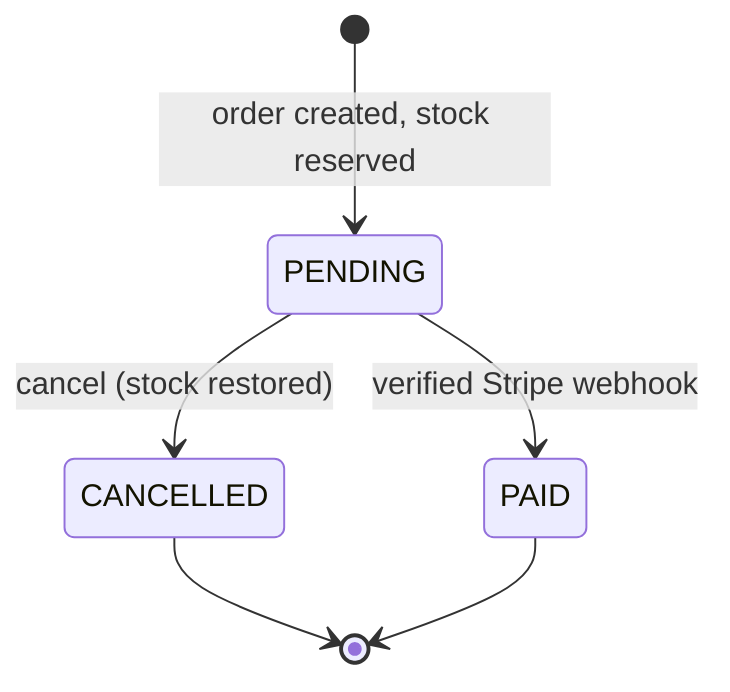

# 🛒 Order Management API

[](https://github.com/stakich/django-order-management-api/actions/workflows/tests.yml)

**A transactional e-commerce backend built with Django REST Framework**

`Django` · `Django REST Framework` · `PostgreSQL 17` · `Stripe Checkout` · `JWT` · `Docker Compose` · `GitHub Actions`

A backend project focused on **inventory consistency under concurrent requests**, **safe payment handling**, **role-based access control** and a **clean separation of business logic from HTTP code**. The whole stack (API + database) starts with one `docker compose up --build`, and every change is verified in CI against a real PostgreSQL instance.

[Features](#-features) · [Engineering decisions](#-key-engineering-decisions) · [Architecture](#-architecture) · [Quick start](#-quick-start-docker) · [API](#-api-overview) · [Payments](#-payments-stripe-checkout) · [Testing & CI](#-testing--ci) · [Roadmap](#-roadmap)

---

## ✨ Overview

The API is the backend of a small online store. Customers browse products, place orders with several items, view and cancel their own orders and pay for them through Stripe Checkout. Administrators manage the catalog and can see all orders.

Creating an order reserves stock, cancelling a pending order restores it, and a verified Stripe webhook marks an order as paid. PostgreSQL transactions and row-level locks keep inventory and payment state consistent even when requests arrive at the same time.

## 🔑 Key engineering decisions

- **All-or-nothing orders:** order creation and stock changes run inside one `transaction.atomic()` block.
- **Row-level locking:** `SELECT ... FOR UPDATE` on products (in a stable `id` order) when stock changes, and on the order and payment rows in a fixed *order → payment* sequence when payment state changes.
- **Retry on serialization failures:** a helper retries order creation and cancellation that fail with PostgreSQL `SQLSTATE 40001`.
- **Service layer:** business rules live in `OrderService` and `PaymentService`; views only handle authentication, validation and HTTP responses.
- **Database-level safety nets:** `CHECK` constraints keep stock and item quantities non-negative, and a partial unique constraint allows only one pending or succeeded payment per order.
- **Price snapshots:** each order item stores its `unit_price` at checkout, so later catalog changes never rewrite past orders.
- **Untrusted payment data:** a Stripe webhook is accepted only with a valid signature, and the amount, currency, mode and metadata are re-checked against the stored payment before an order is marked as paid.
- **Idempotent checkout:** Stripe sessions are created with an idempotency key, and webhook handling is safe to repeat.
- **No information leaks:** orders that belong to other users return `404 Not Found` instead of revealing that they exist.

## ✅ Features

**Products and categories**
- Products with name, description, SKU, price, stock, category and active status
- Product and category endpoints; reads are public, writes require the admin role
- Customers see only active products; admins see all
- Filtering by category and active status, search by name, description and SKU, ordering by price, name and creation date
- Pagination (10 per page by default, up to 100 with `page_size`)

**Accounts and authentication**
- Registration with password confirmation, unique-email validation and Django password validators
- JWT authentication (Simple JWT): access token valid for 30 minutes, refresh token for 1 day
- `UserProfile` with `CUSTOMER` and `ADMIN` roles
- `GET /api/v1/auth/me/` for the current user

**Orders and inventory**
- Create an order with one or more items
- Reject invalid quantities, duplicate products, inactive products and insufficient stock
- List orders and retrieve details (own orders for customers, all orders for admins)
- Cancel a `PENDING` order and restore its stock exactly once
- Cancellation is blocked while a payment is in progress

**Payments (Stripe Checkout, test mode friendly)**
- Create a Checkout Session for an order you own and receive a `checkout_url`
- Verified webhook processing moves the order from `PENDING` to `PAID`
- Expired sessions are detected and a new payment attempt can be started
- Reconciliation services for abandoned or stuck checkouts (see [Payments](#-payments-stripe-checkout))

## 🏗 Architecture

```
Client (HTTP / JSON)                          Stripe
        │                                       │  signed webhook
        ▼                                       ▼
Django REST Framework views  ◄──────────────────┘
  ├─ Authentication and permissions
  ├─ Request validation / serialization
  └─ HTTP response and error mapping
        │
        ▼
Service layer (OrderService, PaymentService)
  ├─ Order creation / cancellation
  ├─ Checkout creation, webhook handling, reconciliation
  ├─ Business rule validation
  └─ Atomic transactions and locking
        │
        ▼
Django ORM → PostgreSQL 17
```

### Project structure

```
.
├── accounts/            # Registration, JWT endpoints, user profiles, roles, permissions
├── products/            # Product catalog and categories (filtering, search, pagination)
├── orders/              # Orders, order items, OrderService, exceptions
│   └── utils/           # Serialization-failure retry helper
├── payments/            # Payment model, PaymentService, checkout and webhook views
├── config/              # Django settings and root URL configuration
├── .github/workflows/   # CI pipeline (tests.yml)
├── Dockerfile           # Application image (gunicorn, non-root user)
├── compose.yaml         # PostgreSQL + web services
├── requirements.txt
├── .env.example         # Example configuration (no real secrets)
└── manage.py
```

### Order lifecycle



### Containers

| Service    | Image                   | Purpose                                                  |
|------------|-------------------------|----------------------------------------------------------|
| `postgres` | `postgres:17`           | Database; data persists in the `postgres_data` volume    |
| `web`      | built from `Dockerfile` | Django API served by gunicorn; migrations run on start   |

- Base image `python:3.14-slim`; dependencies are installed before the code is copied, so rebuilds benefit from layer caching.
- The app runs as an **unprivileged user** and is served by **gunicorn** (3 workers), not the development server.
- Static files (e.g. the Django admin) are collected at build time and served with **WhiteNoise**.
- `web` waits for the PostgreSQL healthcheck, then applies migrations and starts.
- PostgreSQL is published only on `127.0.0.1:5432`.

## 🧰 Tech stack

| Layer              | Technology                                  |
|--------------------|---------------------------------------------|
| Language           | Python 3.14                                 |
| Web framework      | Django 6.1                                  |
| REST API           | Django REST Framework 3.18, django-filter   |
| Authentication     | Simple JWT                                  |
| Database           | PostgreSQL 17 (psycopg 3)                   |
| Payments           | Stripe Checkout (`stripe` Python SDK)       |
| Application server | gunicorn + WhiteNoise                       |
| Containers         | Docker, Docker Compose                      |
| CI                 | GitHub Actions                              |

## 🚀 Quick start (Docker)

**Prerequisites:** Docker with Docker Compose, and Git.

### 1. Clone the project

```bash
git clone https://github.com/stakich/django-order-management-api.git
cd django-order-management-api
```

### 2. Configure environment variables

```bash
cp .env.example .env
```

Edit `.env` and set your own values. Generate a Django secret key with:

```bash
python -c "from django.core.management.utils import get_random_secret_key; print(get_random_secret_key())"
```

| Variable                | Required | Description                                                     |
|-------------------------|----------|-----------------------------------------------------------------|
| `DJANGO_SECRET_KEY`     | yes      | Django secret key                                               |
| `DJANGO_DEBUG`          | no       | `True` for local development; defaults to `False`               |
| `POSTGRES_DB`           | yes      | Database name                                                   |
| `POSTGRES_USER`         | yes      | Database user                                                   |
| `POSTGRES_PASSWORD`     | yes      | Database password (Compose refuses to start without it)         |
| `POSTGRES_HOST`         | no       | Defaults to `127.0.0.1`; Compose sets it to `postgres` for `web`|
| `POSTGRES_PORT`         | no       | Defaults to `5432`                                              |
| `STRIPE_SECRET_KEY`     | for payments | Stripe secret key (use a test key, `sk_test_...`)           |
| `STRIPE_WEBHOOK_SECRET` | for payments | Webhook signing secret (`whsec_...`)                        |
| `STRIPE_SUCCESS_URL`    | yes      | Post-payment success URL setting                                |
| `STRIPE_CANCEL_URL`     | yes      | Post-payment cancel URL setting                                 |

**Never commit `.env`, passwords, private keys or access tokens.**

> `ALLOWED_HOSTS` is not configurable yet, so run with `DJANGO_DEBUG=True` locally (Django then allows `localhost` and `127.0.0.1`). See the [roadmap](#-roadmap).

### 3. Build and start everything

```bash
docker compose up --build
```

This builds the image, starts PostgreSQL, waits until it is healthy, applies migrations and starts the API at `http://127.0.0.1:8000/api/v1/`.

### 4. Create an administrator

In a second terminal, from the project folder:

```bash
docker compose exec web python manage.py createsuperuser
```

This gives access to the Django admin at `http://127.0.0.1:8000/admin/`, where you can add categories and products. To also use the **admin role in the API** (create products through the API, see all orders), give that user an `ADMIN` profile:

```bash
docker compose exec web python manage.py shell -c "from django.contrib.auth import get_user_model; from accounts.models import UserProfile; u = get_user_model().objects.get(username='YOUR_USERNAME'); UserProfile.objects.update_or_create(user=u, defaults={'role': UserProfile.Role.ADMIN})"
```

### Useful commands

```bash
docker compose ps                    # service status
docker compose logs -f web           # follow application logs
docker compose down                  # stop (data is kept)
docker compose down -v               # stop AND delete the database volume
```

> Do not run `docker compose down -v` unless you intentionally want to delete the database.

### Running the app on your machine (optional)

Run only PostgreSQL in Docker and the application locally:

```bash
python -m venv .venv
source .venv/bin/activate            # Windows: .venv\Scripts\activate
pip install -r requirements.txt
docker compose up -d postgres
python manage.py migrate
python manage.py runserver
```

Keep `POSTGRES_HOST=127.0.0.1` in `.env` for this mode. Inside Docker Compose the `web` service reaches the database by the service name `postgres`, which Compose sets automatically.

## 📡 API overview

Base URL: `http://127.0.0.1:8000/api/v1/`

| Method | Endpoint                          | Description                                     | Access                       |
|--------|-----------------------------------|-------------------------------------------------|------------------------------|
| `POST` | `/auth/register/`                 | Register a new user                             | Public                       |
| `POST` | `/auth/login/`                    | Obtain access and refresh tokens                | Public                       |
| `POST` | `/auth/token/refresh/`            | Get a new access token                          | Public (refresh token)       |
| `GET`  | `/auth/me/`                       | Current user                                    | Authenticated                |
| `GET`  | `/products/`, `/products/{id}/`   | List / retrieve products                        | Public                       |
| `POST` `PUT` `PATCH` `DELETE` | `/products/…`      | Manage products                                 | Admin role                   |
| `GET`  | `/categories/`, `/categories/{id}/` | List / retrieve categories                    | Public                       |
| `POST` `PUT` `PATCH` `DELETE` | `/categories/…`    | Manage categories                               | Admin role                   |
| `GET`  | `/orders/`                        | List own orders (all orders for admins)         | Authenticated                |
| `POST` | `/orders/`                        | Create an order                                 | Authenticated                |
| `GET`  | `/orders/{id}/`                   | Retrieve a permitted order                      | Authenticated                |
| `POST` | `/orders/{id}/cancel/`            | Cancel a pending order                          | Owner or admin               |
| `POST` | `/orders/{id}/checkout/`          | Start (or resume) Stripe Checkout for an order  | Owner                        |
| `POST` | `/payments/stripe/webhook/`       | Stripe webhook receiver                         | Stripe signature             |

Product lists support `?category=`, `?is_active=`, `?search=`, `?ordering=price` (also `name`, `created_at`), `?page=` and `?page_size=`.

### Example: register and log in

```bash
curl -i -X POST http://127.0.0.1:8000/api/v1/auth/register/ \
  -H 'Content-Type: application/json' \
  -d '{"username":"alice","email":"alice@example.com","password":"a-Strong-pass-123","password_confirm":"a-Strong-pass-123"}'

curl -X POST http://127.0.0.1:8000/api/v1/auth/login/ \
  -H 'Content-Type: application/json' \
  -d '{"username":"alice","password":"a-Strong-pass-123"}'
```

Store the returned `access` token in your shell without printing it:

```bash
read -rsp 'JWT access token: ' ACCESS_TOKEN; echo
```

Access tokens expire after 30 minutes; log in again (or use the refresh endpoint) if you receive `401`.

### Example: create an order

The item field is named `product` (not `product_id`):

```bash
curl -i -X POST http://127.0.0.1:8000/api/v1/orders/ \
  -H "Authorization: Bearer $ACCESS_TOKEN" \
  -H 'Content-Type: application/json' \
  -d '{"items": [{"product": 1, "quantity": 2}, {"product": 2, "quantity": 3}]}'
```

Expected: `201 Created`, a new `PENDING` order and reduced stock.

### Example: cancel an order

```bash
curl -i -X POST http://127.0.0.1:8000/api/v1/orders/2/cancel/ \
  -H "Authorization: Bearer $ACCESS_TOKEN"
```

Expected: `200 OK` with `"status": "CANCELLED"` and the stock restored. Cancelling the same order again returns `400` and does **not** restore stock a second time.

### Common errors

| Status                    | Meaning                                                                         |
|---------------------------|---------------------------------------------------------------------------------|
| `400 Bad Request`         | Invalid order data, or the order cannot be cancelled / paid in its current state |
| `401 Unauthorized`        | Missing, invalid or expired JWT                                                 |
| `404 Not Found`           | The order does not exist or is not accessible to the user                       |
| `503 Service Unavailable` | The payment provider could not be reached while creating a checkout session     |

## 💳 Payments (Stripe Checkout)

Payments are charged in **EUR**. The amount is always calculated on the server from the stored order items, never taken from the client.

1. `POST /orders/{id}/checkout/` verifies that the order belongs to the caller, is `PENDING` and has no successful payment, then creates (or reuses) a `Payment`.
2. The checkout attempt is *claimed* under row locks, a Stripe Checkout Session is created with an idempotency key, and the session id is saved. The response contains `checkout_url`.
3. While a payment is in progress the order cannot be cancelled.
4. Stripe calls `POST /payments/stripe/webhook/`. The signature is verified, then `checkout.session.completed` / `checkout.session.async_payment_succeeded` mark the payment `SUCCEEDED` and the order `PAID`, and `checkout.session.expired` marks the checkout as expired.
5. If a session expired, calling checkout again confirms with Stripe that it is expired and unpaid, marks the old payment `FAILED` and starts a fresh attempt.

If a webhook arrives before the payment can be found, the endpoint answers `503` so that Stripe retries it.

`PaymentService` also contains reconciliation helpers (`reconcile_known_checkout`, `reconcile_stuck_checkout`) that re-verify a session directly with Stripe and recover abandoned checkout attempts. They are covered by tests; running them on a schedule is on the [roadmap](#-roadmap).

### Trying it locally (optional)

With a Stripe test key in `STRIPE_SECRET_KEY`, forward webhooks with the [Stripe CLI](https://docs.stripe.com/stripe-cli):

```bash
stripe listen --forward-to localhost:8000/api/v1/payments/stripe/webhook/
```

Put the printed `whsec_...` value into `STRIPE_WEBHOOK_SECRET` in `.env` and restart the `web` service.

## 📏 Business rules

1. A new order starts as `PENDING`.
2. An order must contain at least one item with a positive integer quantity.
3. The same product cannot appear twice in one order.
4. Products must be active and have enough stock.
5. Stock changes and order creation happen in one database transaction.
6. Customers see and cancel only their own orders; administrators have broader access.
7. Only `PENDING` orders can be cancelled, and cancellation restores each quantity exactly once.
8. An order with a payment in progress cannot be cancelled.
9. Order item prices are snapshots of the price at checkout.
10. Only the owner can pay for an order, and an order can have at most one pending or succeeded payment.
11. An order is marked `PAID` only after a signed Stripe event whose amount, currency, mode and metadata match the stored payment.

## 🧪 Testing & CI

The project has **61 automated tests** across accounts, catalog, orders and payments. Several of them use real database transactions and threads to check concurrent behaviour:

| Area                 | What is covered                                                                      |
|----------------------|--------------------------------------------------------------------------------------|
| Accounts             | Registration and authentication API                                                  |
| Catalog              | Catalog API                                                                          |
| Orders               | Order services, retry helper, retry behaviour at the API level                       |
| Order concurrency    | Two customers ordering the last unit (exactly one succeeds); row lock blocks a second transaction |
| Payments             | Checkout contract, webhook handling, checkout recovery, concurrent payment attempts  |

Run the tests inside the running stack:

```bash
docker compose exec web python manage.py test -v 2
```

The **Django CI** workflow (`.github/workflows/tests.yml`) runs on every pull request and on pushes to `main`. It starts a PostgreSQL 17 service container and executes:

1. `python manage.py check` — validates the Django configuration
2. `python manage.py makemigrations --check --dry-run` — fails if a model change is missing a migration
3. `python manage.py test -v 2` — runs the whole test suite

Tests run against PostgreSQL (not SQLite) so that transactions and row-level locking behave as they do in the real environment, and they need no Stripe credentials.

## 🛡 Security notes

- Credentials, the Django secret key and Stripe keys are read from environment variables; `.env` is excluded from Git and from the Docker build context.
- JWT is required for order and payment endpoints; ownership checks prevent access to other users' orders.
- Stripe webhooks are verified with the signing secret; payment details are re-validated server-side.
- Failed business operations are rolled back with database transactions.
- The container runs as a non-root user, and PostgreSQL is bound to `127.0.0.1` only.
- `DJANGO_DEBUG=True` is for local development only.

## 🗺 Roadmap

**Done**

- [x] Products and categories with filtering, search and pagination
- [x] Registration, JWT authentication and customer/admin roles
- [x] Transactional order creation with inventory deduction
- [x] Order listing, details and cancellation with stock restoration
- [x] PostgreSQL row locking and serialization-failure retry helper
- [x] Automated tests, including concurrency tests (61 tests)
- [x] Payment model and payment attempt tracking
- [x] Stripe Checkout integration (test mode)
- [x] Verified Stripe webhooks with automatic `PENDING → PAID`
- [x] Idempotent checkout and protection against payment/cancellation races
- [x] Docker image and Docker Compose stack
- [x] CI with a PostgreSQL service, migration check and tests

**Next**

- [ ] Use `STRIPE_SUCCESS_URL` / `STRIPE_CANCEL_URL` when creating the Checkout Session (the session currently uses fixed `localhost` URLs) and serve or point to real success/cancel pages
- [ ] Make `ALLOWED_HOSTS` configurable so the app can run with `DJANGO_DEBUG=False`
- [ ] Run checkout reconciliation on a schedule (management command or periodic job)
- [ ] Manage user roles in the Django admin
- [ ] Linting (`ruff`) and coverage reporting in CI
- [ ] Publish the Docker image from CI (GitHub Container Registry)
- [ ] OpenAPI / Swagger documentation
- [ ] Production deployment with a public URL

---

Built as a hands-on Django backend project by [@stakich](https://github.com/stakich).
